<div align="center">


# Hotel Elegance

### Sistema de Administración Web para el Seguimiento de Reservas

Caso de estudio: **Hotel Elegance** · Av. Saavedra Díaz Romero N.º 1845, Miraflores — La Paz, Bolivia


Plataforma web que centraliza huéspedes, habitaciones y reservas, **impide la doble reserva**
y aplica **Teoría de Decisiones** para apoyar la política de sobreventa del hotel.

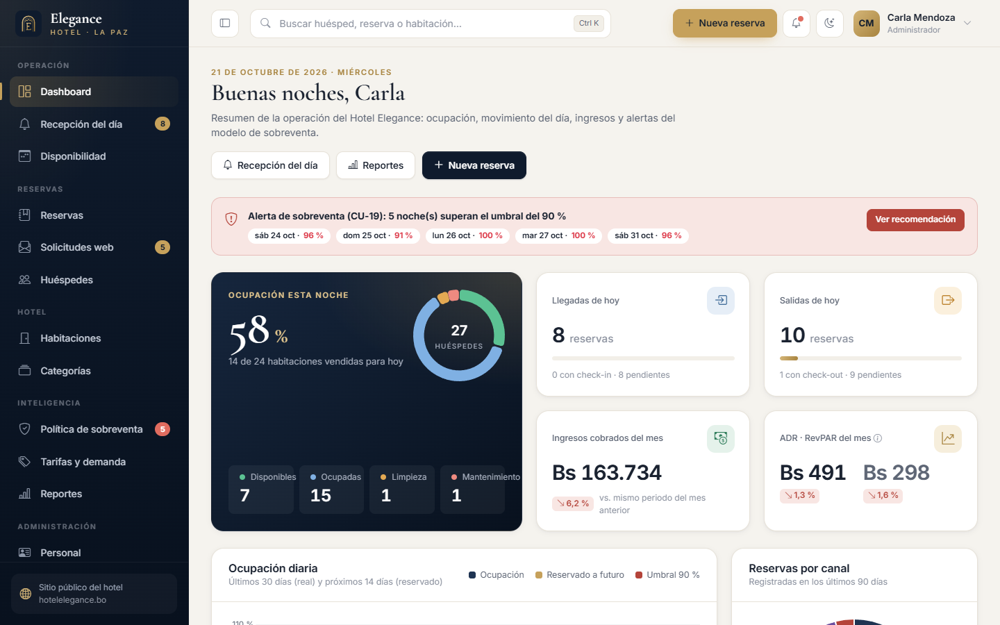

</div>

---

## Contenido

1. [Datos académicos](#datos-académicos) · 2. [Instalación paso a paso](#instalación-paso-a-paso-windows--xampp) · 3. [Usuarios de prueba](#usuarios-de-prueba) · 4. [Módulos, HU y CU](#módulos-historias-de-usuario-y-casos-de-uso) · 5. [Capturas](#capturas) · 6. [Arquitectura](#arquitectura) · 7. [Modelo de datos](#modelo-de-datos) · 8. [Teoría de Decisiones](#teoría-de-decisiones-política-de-sobreventa-sprint-5) · 9. [Tarifa sugerida](#estimación-de-demanda-y-tarifa-referencial-sprint-6) · 10. [Pruebas](#pruebas) · 11. [Solución de problemas](#solución-de-problemas) · 12. [Scrum](#metodología-scrum)

---

## Datos académicos

| | |
|---|---|
| **Universidad** | Universidad Privada Franz Tamayo (UNIFRANZ) — Facultad de Ingeniería |
| **Carrera** | Ingeniería de Sistemas |
| **Asignatura** | Análisis y Diseño II — Evaluación continua, gestión 2026 |
| **Docentes** | Ing. Hilaria Adima Vasquez Duran · Ing. Juan Carlos Cuellar Sonco · Ing. Rubén Gonzalo Soria Soria |
| **Integrantes** | Israel Javier Quispe Escobar · Ademar Rodríguez Mamani · Fernando Jhamil Quispe Ramos · Jonathan Ticona Pérez (Scrum Master) |
| **Especificación** | [`docs/informe.pdf`](docs/informe.pdf) — historias de usuario, Product Backlog, Sprint Backlog, casos de uso CU-01 a CU-24 |
| **Manual de usuario** | [`docs/manual-usuario.md`](docs/manual-usuario.md) |

---

## Requisitos

Solo **XAMPP** para Windows con **PHP 8.0 o superior** (probado con XAMPP 8.2.12: PHP 8.2 + MariaDB 10.4).
No se necesita Composer, Node ni conexión a internet: Bootstrap, los íconos, Chart.js, las tipografías y las imágenes están incluidos en el repositorio.

---

## Instalación paso a paso (Windows + XAMPP)

### 1. Descargar el proyecto

**Opción A — con Git:**

```bash
git clone https://github.com/zeonzev/hotel-elegance.git
```

**Opción B — sin Git:** en la página del repositorio presione **Code → Download ZIP** y descomprima el archivo.

### 2. Copiar la carpeta a `htdocs`

La carpeta debe quedar exactamente así (si descargó el ZIP, renómbrela de `hotel-elegance-main` a `hotel-elegance`):

```
C:\xampp\htdocs\hotel-elegance\
    ├─ app\
    ├─ public\
    ├─ index.php
    └─ ...
```

> El sistema calcula su dirección base automáticamente, así que también funciona en otra subcarpeta de `htdocs`.

### 3. Iniciar Apache y MySQL

Abra el **XAMPP Control Panel** y presione **Start** en **Apache** y en **MySQL** (ambos deben quedar en verde).

### 4. Crear la base de datos (elija una opción)

**Opción A — instalador web (un clic):** abra <http://localhost/hotel-elegance/instalar> y presione **Instalar ahora**.

**Opción B — phpMyAdmin:**

1. Abra <http://localhost/phpmyadmin/>.
2. **Sin seleccionar ninguna base de datos**, haga clic en la pestaña **Importar**.
3. En **Archivo a importar** presione *Seleccionar archivo* y elija `C:\xampp\htdocs\hotel-elegance\database\hotel_elegance.sql`.
4. Deje las demás opciones como están y presione **Importar** (abajo). Debe aparecer *"La importación se ejecutó exitosamente"* y la base **`hotel_elegance`** en el panel izquierdo.

**Opción C — consola:**

```bash
C:\xampp\mysql\bin\mysql.exe -u root < C:\xampp\htdocs\hotel-elegance\database\hotel_elegance.sql
```

> El script crea la base `hotel_elegance` desde cero (si existía, la reemplaza) con estructura, vistas, disparadores y datos de prueba.
> Las fechas de las reservas de prueba son **relativas al día de la importación**: siempre habrá llegadas y salidas "de hoy", huéspedes alojados, reservas futuras y noches con alerta de sobreventa.

### 5. Abrir el sistema

- Sitio público del hotel: <http://localhost/hotel-elegance/>
- Panel administrativo: <http://localhost/hotel-elegance/login>

### ¿Su MySQL tiene contraseña u otro puerto?

Copie `.env.example` como `.env` en la raíz del proyecto y ajuste los valores (o use el instalador web, que lo crea por usted):

```ini
DB_HOST=127.0.0.1
DB_PUERTO=3307
DB_NOMBRE=hotel_elegance
DB_USUARIO=root
DB_CLAVE=su_contraseña
```

---

## Usuarios de prueba

| Rol | Usuario | Contraseña | Qué puede hacer |
|---|---|---|---|
| Administrador | `admin` | `Admin123*` | Todo: personal, cuentas y roles, habitaciones, categorías, tarifas, parámetros de sobreventa, configuración y bitácora |
| Recepcionista | `recepcion` | `Recepcion123*` | Huéspedes, estados de habitación, reservas, disponibilidad, check-in/check-out, solicitudes web |
| Gerente | `gerente` | `Gerente123*` | Dashboard, política de sobreventa, tarifas (consulta) y reportes |
| Recepcionista (primer ingreso) | `rcondori` | `Elegance2026*` | Demuestra el cambio obligatorio de contraseña (CU-04, flujo 3a) |

En la pantalla de acceso hay botones para completar estas credenciales con un clic.
Tras **5 intentos fallidos** la cuenta queda **BLOQUEADA** y solo el administrador puede desbloquearla (*Usuarios y roles*).

---

## Módulos, historias de usuario y casos de uso

| Sprint / módulo | HU | Casos de uso | Dónde está en el sistema |
|---|---|---|---|
| 1 · Sesiones | 1–4 | CU-01 Registrar personal · CU-02 Crear cuenta de usuario · CU-03 Asignar rol · CU-04 Iniciar sesión | Administración → Personal / Usuarios y roles · `/login` |
| 2 · Gestión de Huéspedes | 5–7 | CU-05 Registrar huésped · CU-06 Modificar datos · CU-07 Consultar historial | Reservas → Huéspedes |
| 3 · Gestión de Habitaciones | 8–10 | CU-08 Gestionar habitaciones · CU-09 Gestionar categorías · CU-10 Actualizar estado | Hotel → Habitaciones (plano por piso) / Categorías |
| 4 · Gestión de Reservas | 11–16 | CU-11 Registrar reserva · CU-12 Consultar disponibilidad · CU-13 Modificar · CU-14 Cancelar · CU-15 Check-in · CU-16 Check-out | Reservas · Disponibilidad (calendario) · Recepción del día |
| 5 · Política de Sobreventa | 17–19 | CU-17 Tasa de cancelación y no-show · CU-18 Valor esperado de sobreventa · CU-19 Alertar sobreventa | Inteligencia → Política de sobreventa · alerta en dashboard, recepción y nueva reserva |
| 6 · Demanda y Tarifas | 20–21 | CU-20 Configurar tarifas por temporada · CU-21 Sugerir tarifa referencial | Inteligencia → Tarifas y demanda |
| 7 · Reportes | 22–24 | CU-22 Ocupación · CU-23 Ingresos · CU-24 Cancelaciones | Inteligencia → Reportes (CSV, Excel y PDF) |

**Extras:** dashboard ejecutivo (ocupación, ADR, RevPAR, canales, alertas), sitio público conectado a la misma base (las solicitudes llegan a recepción),
instalador web, búsqueda global (Ctrl + K), bitácora de auditoría, notificaciones, modo claro/oscuro y diseño responsive.

---

## Capturas

| Sitio público | Inicio de sesión |
|---|---|
| 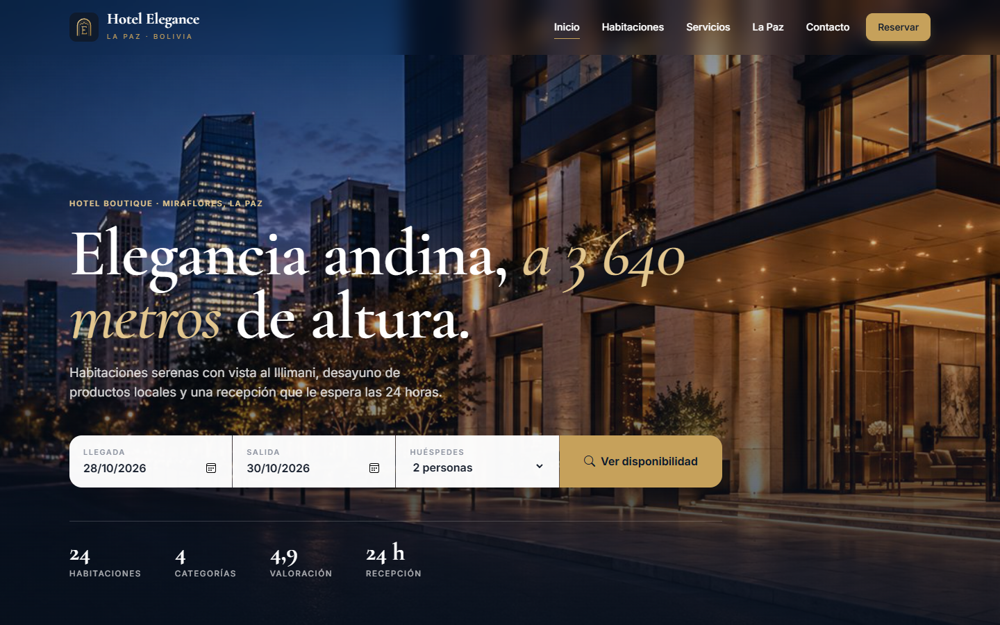 | 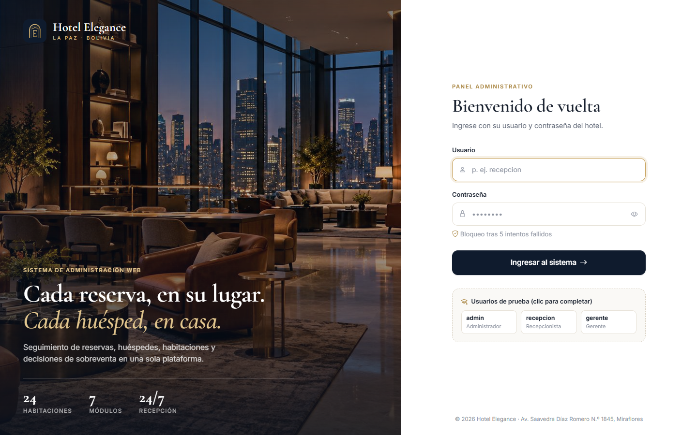 |
| **Nueva reserva (CU-11 + CU-12 + CU-19)** | **Calendario de ocupación (CU-12)** |
| 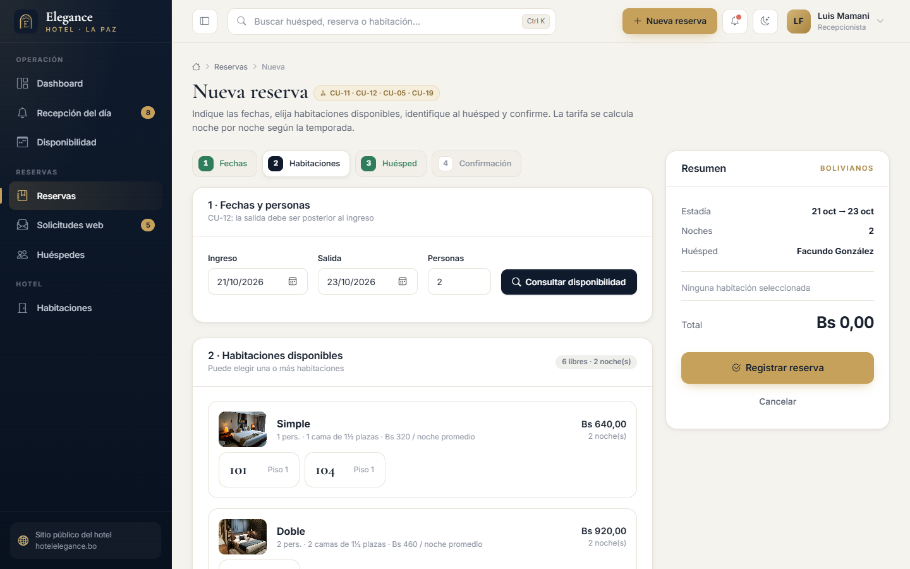 | 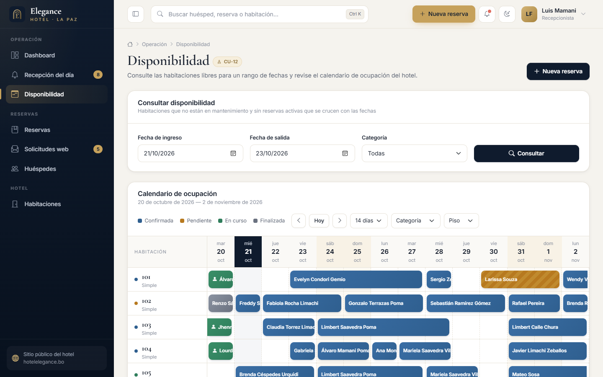 |
| **Recepción del día (CU-15 / CU-16)** | **Plano de habitaciones por piso (CU-10)** |
| 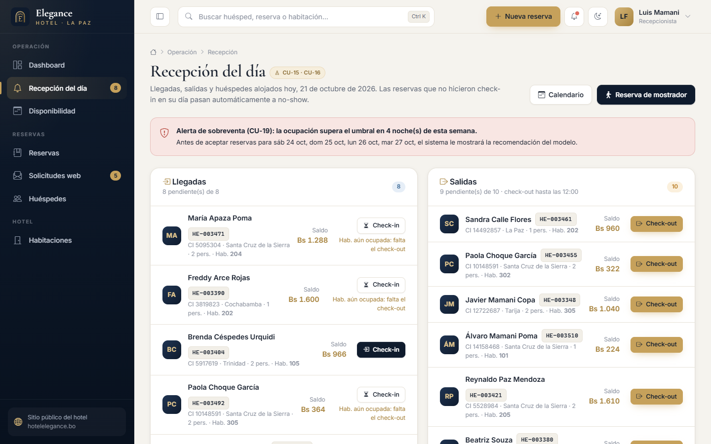 | 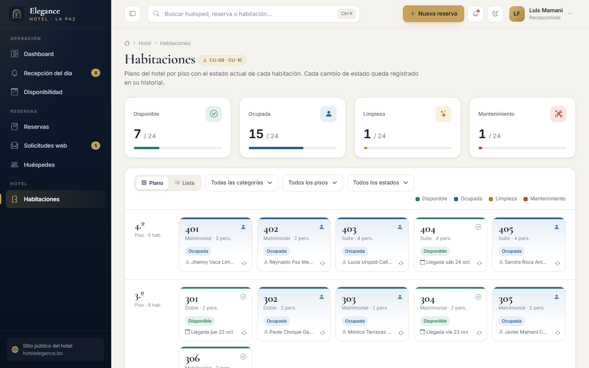 |
| **Política de sobreventa (CU-17 / 18 / 19)** | **Tarifa referencial sugerida (CU-21)** |
| 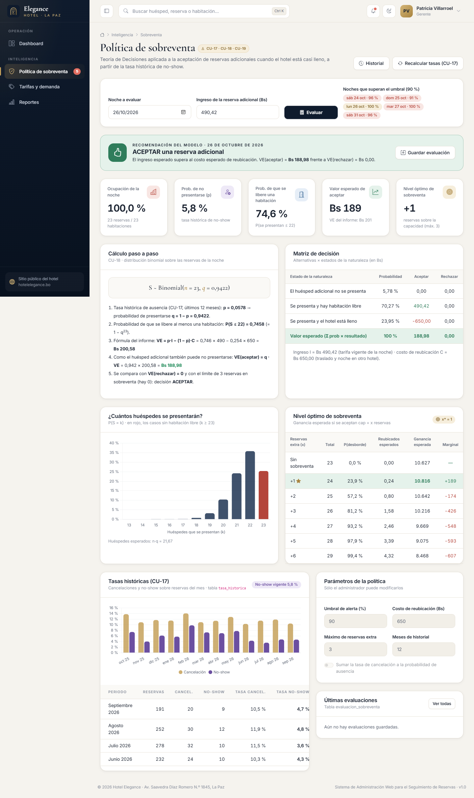 | 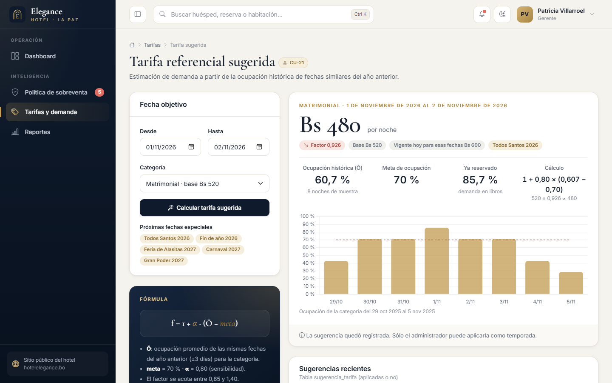 |
| **Reporte de ingresos (CU-23)** | **Recibo imprimible (CU-16)** |
| 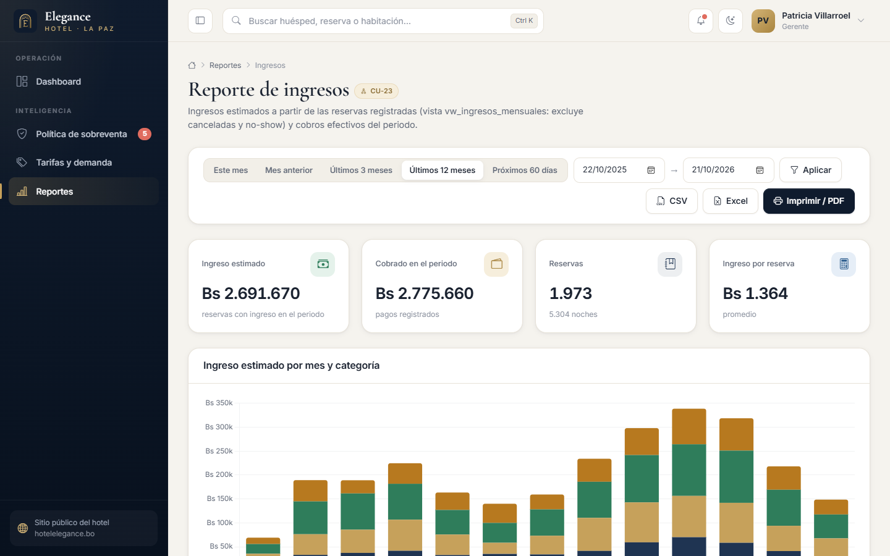 | 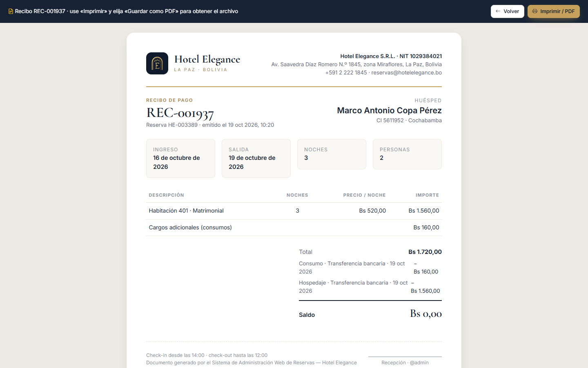 |
| **Usuarios, roles y permisos (CU-02 / CU-03)** | **Modo oscuro** |
| 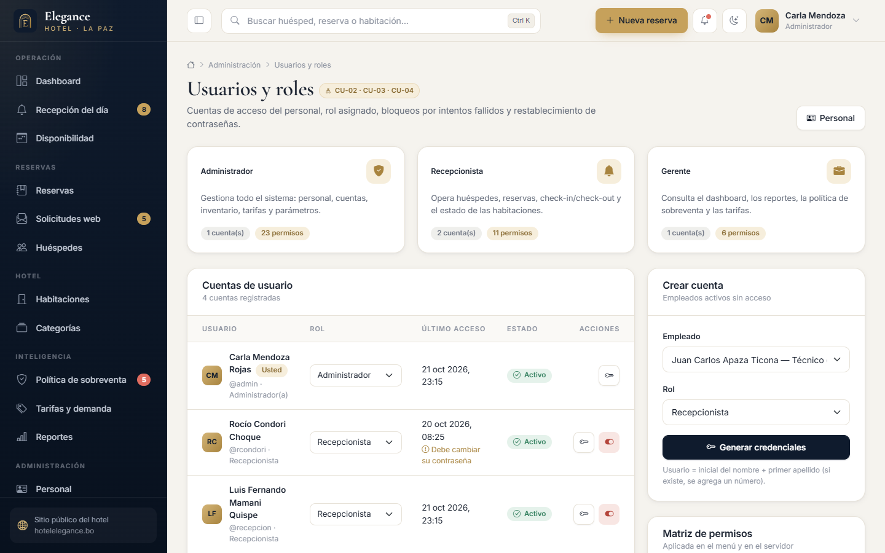 | 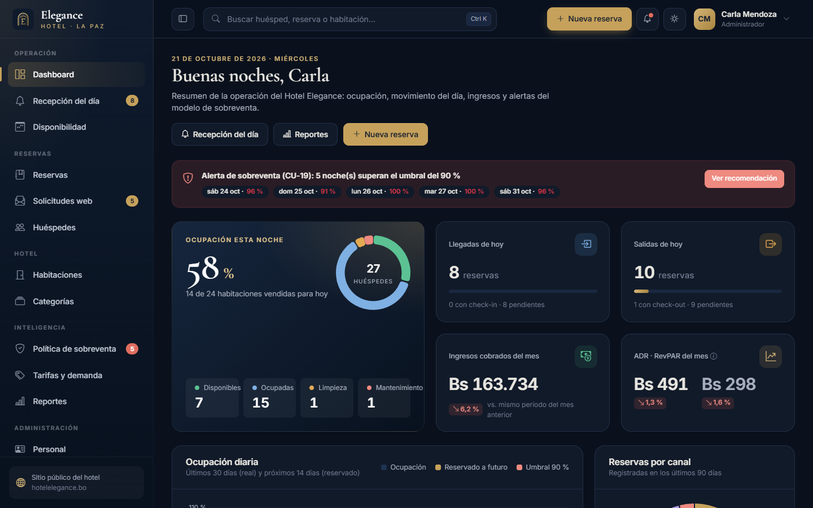 |

---

## Arquitectura

MVC propio, sin frameworks, con autocarga PSR-4 (`App\` → `app/`) y un único punto de entrada.

```
hotel-elegance/
├─ index.php               → entrada para http://localhost/hotel-elegance/ (delega en public/)
├─ .htaccess               → envía todo a public/ y bloquea app/, config/, database/...
├─ public/
│  ├─ index.php            → front controller
│  ├─ assets/              → css (sistema de diseño), js, img, fuentes locales
│  └─ vendor/              → Bootstrap 5.3, Bootstrap Icons, Chart.js (sin CDN)
├─ app/
│  ├─ Core/                → Aplicacion, Enrutador, Solicitud, Respuesta, BaseDatos (PDO),
│  │                          Vista, Sesion, Csrf, Validador, Autenticacion, Paginador, errores
│  ├─ Middleware/          → Autenticado, Invitado, Permiso (por rol), VerificarCsrf
│  ├─ Controllers/         → un controlador por módulo
│  ├─ Repositorios/        → acceso a datos (consultas preparadas)
│  ├─ Servicios/           → lógica de negocio: reservas, disponibilidad, sobreventa (ModeloDecision),
│  │                          tarifas, demanda, reportes, exportación CSV/XLSX, instalador
│  └─ Vistas/              → layouts (panel, sitio, acceso, impresión), parciales y vistas por módulo
├─ config/                 → config.php (lee .env), rutas.php, permisos.php (matriz de roles)
├─ database/
│  ├─ hotel_elegance.sql   → estructura + vistas + disparadores + datos de prueba (un solo archivo)
│  └─ scripts/             → esquema.sql y generador de datos (generar_sql.php)
├─ docs/                   → informe.pdf, manual de usuario y capturas
├─ storage/logs/           → registro de errores
└─ tests/                  → pruebas automatizadas y prueba de humo por rol
```

**Flujo de una petición:** `public/index.php` → `Enrutador` (CSRF en todo POST → `Autenticado` → `Permiso:<permiso>`) → `Controlador` → `Servicio` / `Repositorio` (PDO) → `Vista` dentro de un layout.

**Seguridad:** contraseñas con `password_hash()`, bloqueo tras 5 intentos, cambio obligatorio de la contraseña por defecto,
sesión con cookie HttpOnly/SameSite y regeneración de ID, cierre por inactividad, token CSRF en todos los formularios,
escape de salida (`e()`), consultas preparadas, validación en cliente y servidor, permisos por rol verificados en el servidor,
encabezados de seguridad, campo trampa anti-bots en el sitio público y páginas de error 403/404/500 propias. Las acciones importantes quedan en la **bitácora**.

### Garantía contra la doble reserva

1. Dentro de una **transacción** se bloquean las habitaciones elegidas (`SELECT … FOR UPDATE`): dos recepcionistas que intentan la misma habitación quedan en fila.
2. Se verifica que no exista otra reserva activa que se cruce: `ingreso < salida_otra AND salida > ingreso_otra`.
3. Como última defensa, los **disparadores** `trg_detalle_reserva_antitraslape_*` y `trg_reserva_antitraslape_upd`
   rechazan cualquier traslape aunque se inserte por fuera del sistema (por ejemplo, desde phpMyAdmin).

---

## Modelo de datos

27 tablas (partiendo del modelo de 21 tablas del equipo, alineado con los nombres del informe), 3 vistas y 4 disparadores.

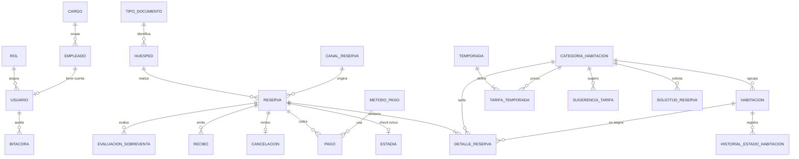

Otras tablas: `tasa_historica`, `configuracion_sobreventa`, `mensaje_contacto`, `configuracion`.
Vistas: `vw_historial_huesped` (CU-07), `vw_ingresos_mensuales` (CU-23), `vw_reporte_cancelaciones` (CU-24).
Disparadores: tres anti-traslape y `trg_cancelacion_reserva` (CU-14: al registrar la cancelación, la reserva pasa a CANCELADA).

**Datos de prueba:** 24 habitaciones en 4 pisos (Simple, Doble, Matrimonial y Suite), 8 empleados, 320 huéspedes con nombres
y procedencias realistas (Bolivia, Perú, Argentina, Chile, Europa...) y unas 2 650 reservas en los últimos 12 meses y los
próximos 2 meses (finalizadas con pagos en Bs, canceladas con motivo, no-show, en curso, futuras y 2 en sobreventa), además
de temporadas como Alasitas, Carnaval, Gran Poder y Todos Santos. Se usó un volumen mayor a 200 reservas para que la ocupación,
el ADR/RevPAR y las tasas de no-show tengan valores realistas en un hotel de 24 habitaciones.

---

## Teoría de Decisiones: política de sobreventa (Sprint 5)

Cuando el hotel está casi lleno, ¿conviene aceptar **una reserva adicional**? Algunos huéspedes confirmados no se presentan
(no-show), pero si todos llegan el hotel debe **reubicar** a uno en otro hotel y asumir un costo.

**Datos:** `n` reservas confirmadas para la noche, `cap` habitaciones, tasa histórica de no-show `p` (CU-17), probabilidad de
presentarse `q = 1 − p`, ingreso `I` de la reserva adicional (tarifa vigente) y costo de reubicación `C` (configurable).

El número de huéspedes que se presentan sigue una **distribución binomial** `S ~ Binomial(n, q)`:

```
P(S = k) = C(n, k) · q^k · (1 − q)^(n − k)

p_libera = P(S ≤ cap − 1)                   → probabilidad de que quede al menos una habitación libre
VE(aceptar)  = q · [ p_libera · I − (1 − p_libera) · C ]
VE(rechazar) = 0
Decisión: ACEPTAR si VE(aceptar) > 0 y no se superó el máximo de reservas extra (CU-18, flujo 5a)
```

La fórmula del informe, `VE = p·I − (1 − p)·C`, es el mismo cálculo cuando `p` es la probabilidad de que se libere una habitación.
Además, la **matriz de decisión** muestra las alternativas (aceptar / rechazar) frente a los estados de la naturaleza, y se calcula
la **ganancia esperada para cada nivel de sobreventa** (`cap + x` reservas) para elegir el **nivel óptimo** `x*`.

**Ejemplo numérico** (hotel lleno: `n = cap = 23`, `p = 5,5 %`, `I = Bs 520`, `C = Bs 650`):

| Paso | Cálculo | Resultado |
|---|---|---|
| Prob. de que todos se presenten | 0,945²³ | 0,272 |
| Prob. de que se libere al menos una | 1 − 0,272 | **0,728** |
| VE fórmula del informe | 0,728 · 520 − 0,272 · 650 | **Bs 201,8** |
| VE binomial (el extra puede fallar) | 0,945 · 201,8 | **Bs 190,7** |
| Decisión | 190,7 > 0 | ✅ **ACEPTAR** |

Si la ocupación de alguna noche supera el **umbral** configurado (90 % por defecto), el sistema muestra la **alerta de sobreventa**
(CU-19) en el dashboard, en recepción y en el registro de la reserva. Si ya no quedan habitaciones de la categoría, la reserva se puede
aceptar **en sobreventa** (sin habitación asignada) cuando el modelo recomienda ACEPTAR; si recomienda RECHAZAR, solo un administrador
puede autorizarla (CU-19, flujo 4a). La habitación se asigna después o en el check-in.

## Estimación de demanda y tarifa referencial (Sprint 6)

```
Ō  = ocupación promedio de las mismas fechas del año anterior (± 3 días) para la categoría
f  = 1 + α · (Ō − meta)        acotado entre 0,85 y 1,40     (α = 0,8 ; meta = 70 %)
tarifa sugerida = tarifa base × f   (redondeada a Bs 10)
```

**Ejemplo:** Matrimonial (base Bs 520) en Gran Poder con `Ō = 88 %` → `f = 1 + 0,8 · (0,88 − 0,70) = 1,144` → **Bs 590** por noche.
La tarifa vigente de cada noche sigue la prioridad: fecha especial > temporada alta > temporada baja > tarifa base, y el monto de cada
reserva se calcula noche por noche. Una sugerencia puede **aplicarse** con un clic: se crea una temporada especial con ese precio.

---

## Pruebas

**Pruebas automatizadas** (30 casos: modelo binomial, tarifa sugerida, validación, doble reserva, disparadores, cancelación,
prioridad de tarifas, tasas CU-17, inicio de sesión y bloqueo, permisos por rol). Se ejecutan dentro de una transacción que se revierte:

```bash
C:\xampp\php\php.exe tests\ejecutar.php
```

**Prueba de humo** de ~70 rutas con los tres roles (respuestas, permisos 403 y ausencia de errores PHP):

```bash
C:\xampp\php\php.exe tests\humo.php
```

Además se verificó con un navegador real (Edge sin interfaz): flujo completo de nueva reserva → check-in → check-out → recibo,
cero errores de JavaScript, 461 enlaces internos sin roturas y sin desbordes en pantallas de celular.

---

## Solución de problemas

| Problema | Solución |
|---|---|
| **Apache no inicia (puerto 80 ocupado)** | Cierre Skype/IIS/otro servidor, o en XAMPP → Apache → Config → `httpd.conf` cambie `Listen 80` por `Listen 8080` y abra `http://localhost:8080/hotel-elegance/`. |
| **MySQL no inicia (puerto 3306 ocupado)** | Detenga otro MySQL instalado como servicio, o cambie el puerto en `my.ini` (p. ej. 3307) y ponga `DB_PUERTO=3307` en `.env`. |
| **Aparece "Falta un paso para empezar"** | La base no existe o MySQL está apagado: inicie MySQL y use el instalador `/instalar` o importe `database/hotel_elegance.sql`. |
| **Error de conexión (1045, acceso denegado)** | Su usuario root tiene contraseña: indíquela en el instalador o cree `.env` con `DB_CLAVE=...`. |
| **Las rutas devuelven 404 de Apache** | Verifique que el proyecto esté en `htdocs\hotel-elegance` y que en `httpd.conf` esté activo `LoadModule rewrite_module` con `AllowOverride All` (por defecto en XAMPP). Sin mod_rewrite también funciona usando `http://localhost/hotel-elegance/index.php/login`. |
| **Página en blanco o error 500** | Revise `storage/logs/errores.log`. Para ver el detalle, cree `.env` con `APP_DEBUG=true`. |
| **La importación falla en phpMyAdmin** | Importe sin seleccionar una base (el script crea `hotel_elegance`), use el instalador web o la opción por consola. |
| **No aparecen llegadas "de hoy"** | Los datos son relativos a la fecha de importación; vuelva a importar el SQL (o reinstale desde `/instalar`) para regenerarlos. |

---

## Metodología Scrum

| Rol | Persona |
|---|---|
| Product Owner | Gerencia del Hotel Elegance |
| Scrum Master | Jonathan Ticona Pérez |
| Development Team | Israel J. Quispe E. · Ademar Rodríguez M. · Fernando J. Quispe R. · Jonathan Ticona P. |

| Sprint | Módulo | Historias (responsable) |
|:---:|---|---|
| 1 | Sesiones | HU1 Registro de personal (Ademar) · HU2 Cuentas de usuario (Israel) · HU3 Asignación de roles (Jhamil) · HU4 Inicio de sesión (Jonathan) |
| 2 | Gestión de Huéspedes | HU5 Registro de huéspedes (Jhamil) · HU6 Modificar datos (Israel) · HU7 Historial (Jonathan) |
| 3 | Gestión de Habitaciones | HU8 Habitaciones (Ademar) · HU9 Categorías (Jonathan) · HU10 Estado de habitación (Israel) |
| 4 | Gestión de Reservas | HU11 Registrar (Ademar) · HU12 Disponibilidad (Jhamil) · HU13 Modificar (Jonathan) · HU14 Cancelar (Israel) · HU15 Check-in (Ademar) · HU16 Check-out (Jhamil) |
| 5 | Política de Sobreventa | HU17 Tasas (Jonathan) · HU18 Valor esperado (Ademar) · HU19 Alerta (Israel) |
| 6 | Estimación de Demanda y Tarifas | HU20 Tarifas por temporada (Jhamil) · HU21 Tarifa referencial (Ademar) |
| 7 | Reportes | HU22 Ocupación (Jonathan) · HU23 Ingresos (Jhamil) · HU24 Cancelaciones (Ademar) |

El historial de commits del repositorio sigue el mismo orden de sprints.

---

## Créditos

- Tipografías *Cormorant Garamond* e *Inter* (SIL Open Font License), Bootstrap 5.3 e íconos Bootstrap (MIT), Chart.js 4 (MIT).
- Fotografías de habitaciones: [Unsplash](https://unsplash.com) (licencia Unsplash). Panorama de La Paz: René Denis, [Wikimedia Commons](https://commons.wikimedia.org/wiki/File:La_Paz_panorama_December_1_2008.jpg) (CC BY 3.0).
- Proyecto académico — UNIFRANZ, La Paz, 2026.
